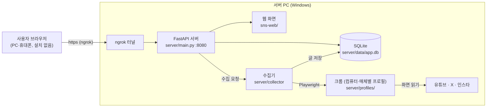

# SNS Collector — SNS 신규글 모아보기

유튜브(영상·게시물), X, 인스타그램에서 보고 싶은 계정의 새 글을 **한 화면에 모아 보는** 웹 서비스입니다.

- 사용자는 아무것도 설치하지 않고 **아이디·비밀번호로 로그인만** 하면 됩니다.
- 글은 서버 PC의 크롬이, 미리 로그인해 둔 테스트 계정으로 각 사이트 화면을 읽어서 모읍니다. 공식 API나 유료 서비스는 쓰지 않습니다.
- 팀: WebMonster ([WM-WebMonsters](https://github.com/WM-WebMonsters))

웹 화면 사용법은 [sns-web/README.md](sns-web/README.md)를 보세요. 이 문서는 서버를 운영·개발하는 사람을 위한 것입니다.

---

## 구조



| 폴더 | 역할 |
|---|---|
| `server/` | Python 서버(FastAPI). 로그인 API, 글·추적 계정 API, 수집기(Playwright) |
| `sns-web/` | 웹 화면(HTML/CSS/JavaScript, 빌드 없음). 서버가 그대로 제공합니다 |

---

## 수집은 언제, 어떻게 하나요

### 수집이 일어나는 때

| 언제 | 대상 | 비고 |
|---|---|---|
| 사용자가 **지금 최신화**를 누름 | 그 사용자의 추적 계정 | 수집 중에 두 번 누르면 멈춥니다 |
| 사용자가 **계정을 추가**함 | 추가한 계정 | 다른 수집이 진행 중이면 끝난 뒤 이어서 |
| 사용자가 **아이디·비밀번호로 로그인**함 | 그 사용자의 추적 계정 | 항상 |
| 저장된 로그인으로 **화면을 다시 엶** | 그 사용자의 추적 계정 | 마지막 수집 뒤 10분이 지났을 때만(새로고침마다 돌지 않게) |
| 서버가 켜져 있으면 **30분마다** | 모든 사용자의 추적 계정(겹치는 계정은 한 번만) | 첫 화면 위주로 가볍게. 최근 20분 안에 모은 페이지는 건너뜀 |
| 숨긴 묶음을 **다시 보이게** 함 | 그 묶음의 계정 | 숨긴 동안 못 모은 글을 바로 모음 |

**숨긴 묶음**(추적 계정 관리에서 숨김)의 계정은 위 어느 경우에도 모으지 않습니다. 다만 같은 계정을 숨기지 않은 다른 사용자가 있으면 그 사용자 몫으로는 모읍니다.

### 한 페이지를 모으는 방식

1. 수집기가 매체별 크롬 창에서 계정 페이지를 엽니다. 유튜브 채널은 *동영상*·*쇼츠*·*게시물* 탭 세 곳이고, 탭마다 창이 따로라 셋을 동시에 모읍니다.
2. 페이지 안에서 `server/collector/scripts/*.js`가 스크롤하며 글을 읽어 서버로 넘깁니다. 유튜브 채널은 스크롤하지 않고, 유튜브가 화면용으로 쓰는 데이터 요청으로 목록을 받습니다.
   - **쇼츠**는 일반 영상과 같은 '유튜브 영상'으로 저장해서, 목록에서 날짜순으로 섞여 보입니다(웹에서 열면 세로 화면).
   - 쇼츠 탭 목록에는 날짜가 없습니다. 날짜는 유튜브가 공개로 주는 채널 RSS(`/feeds/videos.xml`, **최근 업로드 15개**·영상과 쇼츠 섞임)에서 받습니다.
   - RSS는 페이지 안에서 글자로 읽습니다. 유튜브 페이지는 Trusted Types 보안 정책 때문에 `DOMParser`가 막혀서, 예전에는 날짜를 하나도 못 얻어 쇼츠가 전혀 모이지 않았습니다.
   - RSS에 없는 쇼츠는 쇼츠 하나의 정보 요청(`youtubei/v1/player`, 약 9KB·0.3초, 페이지를 열지 않음)으로 정확한 게시 시각을 받습니다. 모든 쇼츠를 묻지 않고:
     - 목록 묶음(약 48개)마다 마지막 쇼츠만 묻고, 가져올 기간의 끝이 그 묶음 안이면 **이진 탐색**으로 경계를 찾습니다.
     - 경계 안쪽은 정확히 아는 시각 사이를 순서대로 나눠 채우고(보간), 두 기준 시각이 하루보다 멀면 가운데를 더 물어 좁힙니다. 쇼츠끼리의 순서는 정확하고, 날짜 오차는 하루 이내입니다.
     - 묻는 사이에 0.3~0.6초씩 쉬고, 한 번 수집에 최대 150번까지만 묻습니다. 한도를 넘거나 요청이 실패하면 예전처럼 날짜를 모르는 쇼츠에서 멈추고 저장하지 않습니다(날짜 없이 저장하면 최신 글로 잘못 정렬되기 때문).
     - 시험 결과(2개월·14일 기간): 쇼츠 28개 → 15초, 40개 → 18초, 236개(뉴스 채널) → 묻기 약 30번·21초, 평균 오차 0.2~2.7시간.
     - 평소 수집(새 쇼츠가 RSS 안)에는 추가 요청이 없습니다. 쇼츠 탭이 없는 채널은 바로 넘어갑니다.
3. **최신 글부터** 보다가 다음 중 하나가 되면 멈춥니다.
   - 이미 모은 글이 연달아 6개 나옴(고정 게시물·리포스트는 세지 않음)
   - 가져올 기간보다 오래된 글이 나옴
   - 목록 끝에 닿음
4. 처음부터 기간 끝까지 다시 모으는 경우는 다음뿐입니다.
   - 새로 추가한 계정
   - 기간을 늘린 계정
   - '수집한 글 모두 삭제'를 누른 뒤
   - 지난 수집이 새 글을 모으다 중간에 끊긴 페이지

### 봇 탐지를 피하려고 하는 것

X·인스타는 자동 수집을 막을 수 있어서 테스트 계정이 잠길 수 있습니다. 그래서 다음을 지킵니다.

| 규칙 | 값 | 코드 |
|---|---|---|
| 같은 페이지를 다시 여는 최소 간격(사용자가 누른 수집도 적용) | X·인스타 30초, 유튜브 0초 | `USER_MIN_GAP_MS` |
| 계정 검색 페이지를 다시 여는 최소 간격(취소 후 새로 검색·여러 사람이 잇달아 검색해도). 수집용·검색용 계정이 따로여도 같은 IP이므로, 그 매체의 페이지를 마지막으로 연 때(수집 포함)부터 셈 | X·인스타 2초, 유튜브 0초 | `SEARCH_MIN_GAP` |
| 수집용과 검색용 계정 분리 | X·인스타 계정 검색은 검색용 계정으로만 | `SEARCH_ACCTS` |
| 같은 매체 안에서 페이지 사이 쉬는 시간 | 인스타 1.5~3초, X 1~2초, 유튜브 0.4~0.8초 | `_gap` |
| 로딩이 도중에 멈춘 페이지(속도 제한 등)를 끝까지 다시 내려가 보기 | 하루에 한 번만 | `STALL_RETRY_MS` |
| 로그인 화면으로 넘어간 매체 | 바로 멈추고 남은 페이지는 열지 않음. 매체 아이콘이 회색이 됨 | `_gone` |
| 멈추기·시간 초과된 페이지 | 빈 페이지로 옮겨 스크롤을 끝냄 | `_halt` |
| 인스타 게시 날짜 | 인스타 화면이 원래 받아 오는 응답을 읽기만 함(날짜용 추가 요청 없음) | `_ig_pump` |
| 숨긴 묶음 | 수집하지 않음(보지 않는 계정의 방문을 줄임) | `extend`, `_auto` |

최소 간격 안에 누른 수집은 버리지 않습니다. 남은 시간만큼 기다렸다가 이어서 모으고, *현재 작업* 카드에 "약 N초 뒤 확인"으로 보여 줍니다.

---

## 서버 실행 (관리자)

준비물: **Windows PC, Python 3.12, 구글 크롬, ngrok 계정**

### 처음 한 번 (컴퓨터마다)

외장 SSD처럼 같은 폴더를 여러 컴퓨터에서 써도 됩니다. 다음은 컴퓨터마다 따로 저장됩니다.
- 가상환경: `server\.venv-컴퓨터이름`
- 테스트 계정 로그인 정보: `server\profiles\컴퓨터이름\`

그래서 **새 컴퓨터에서는 아래를 한 번씩** 해 주면 됩니다. DB(`server\data`)는 모든 컴퓨터가 함께 씁니다.

1. **Python 설치**: python.org에서 3.12를 설치합니다. 첫 화면에서 *Add python.exe to PATH*를 체크하세요.
2. **패키지 설치**: `server\setup.bat`을 더블클릭합니다. "Setup complete"가 나오면 끝입니다. 패키지 버전은 `server\requirements.txt`에 고정되어 있습니다.
3. **ngrok 설치·등록**
   ```bat
   winget install ngrok.ngrok
   ngrok config add-authtoken <대시보드의 토큰>
   ```
   - ngrok 대시보드 → Domains에서 받은 고정 주소를 `server\start.bat`의 `NGROK_URL`에 적습니다.
   - 토큰 등록은 컴퓨터마다 해야 합니다.
   - 무료 계정은 고정 주소를 한 번에 한 컴퓨터에서만 열 수 있습니다.
4. **테스트 계정 로그인**: `server\login_setup.bat`을 실행합니다. 크롬 창 4개가 열리면 각 창에서 해당 테스트 계정으로 로그인한 뒤 창을 모두 닫습니다.

   | 크롬 프로필 | 로그인할 계정(창) | 쓰는 곳 |
   |---|---|---|
   | `collect` | `x`, `instagram`: 수집용 테스트 계정 | 추적 계정의 글 **수집**, 유튜브 수집 |
   | `search` | `x-search`, `instagram-search`: 검색용 테스트 계정(**수집용과 다른 계정**) | 웹의 **계정 찾기**(이름 검색), 유튜브 검색·유튜브 게시물 읽기 |

   - 한 프로필에 X·인스타를 함께 로그인합니다. 사이트마다 쿠키가 따로라 한 크롬에 둘 다 로그인해 둘 수 있습니다.
   - 유튜브는 로그인하지 않아도 되므로 창을 열지 않습니다.
   - 검색은 짧은 간격으로 검색 요청을 보내 봇처럼 보이기 쉽습니다. 그래서 검색 계정을 따로 둡니다. 검색 계정이 막혀도 수집 계정은 살아 있고, 검색과 수집이 같은 창을 두고 서로 기다리지 않습니다.
   - `login_setup`은 로그인 창을 연 계정을 프로필 안(`sns_login_setup.json`)에 기록합니다. 서버는 이 기록으로 준비된 계정을 알고, 켜질 때 그 뒤로 확인하지 않은 계정의 로그인 상태를 다시 확인합니다.
   - 예전 방식의 프로필 폴더(`youtube`, `x`, `instagram`, `x-search`, `instagram-search`)는 더 쓰지 않습니다. 지워도 됩니다.
   - 서버가 켜져 있으면 먼저 끄세요. 같은 크롬 프로필을 동시에 쓸 수 없습니다.
   - 크롬 로그인 정보는 만든 컴퓨터에서만 풀리므로, 컴퓨터마다 한 번씩 로그인해야 합니다.
   - 일부만 하려면 이름을 붙입니다: `login_setup.bat x-search instagram-search`
   - 검색용 계정을 아직 만들지 않았으면 X·인스타 이름 검색은 "검색용 테스트 계정이 아직 준비되지 않아…"로 안내하고 하지 않습니다. 이때도 `@아이디`·프로필 주소로는 바로 추가할 수 있습니다.
5. **관리자 계정**: `server\admin_setup.bat`으로 정합니다. 웹 가입으로는 관리자를 만들 수 없습니다. 서버가 켜져 있어도 됩니다.
   ```
   admin_setup.bat admin                      아이디를 관리자로(없으면 비밀번호를 물어보고 새로 만듦)
   admin_setup.bat admin --password <비밀번호>  비밀번호까지 한 번에(있는 아이디면 비밀번호도 바꿈)
   admin_setup.bat admin --revoke             관리자 해제(마지막 관리자는 해제 못 함)
   admin_setup.bat --list                     관리자 목록
   ```
   - 관리자로 로그인하면 왼쪽 레일에 방패 모양 **관리** 탭이 생깁니다(아래 '관리 탭').
   - 서버가 ngrok으로 밖에 열려 있으므로 관리자 비밀번호는 짐작하기 어려운 것으로 바꿔 두세요(계정 메뉴 → 계정 관리 → 비밀번호 변경).

### 관리 탭 (관리자만)

| 화면 | 할 수 있는 것 |
|---|---|
| 사용자 | 모든 사용자 아이디(관리자·비밀번호 초기화됨 표시, 로그인된 기기·수집 중 점). 누르면 등록한 SNS 계정을 묶음별로(숨김·기간·글 수) 보여 줍니다. 계정·묶음을 골라 **기간·묶기·묶음 풀기·숨기기/보이기·제거**, 묶음 이름 바꾸기, 매체별 수집 켜기/끄기, 기본 기간, **지금 수집·수집 멈추기**, 수집한 글 비우기, 본 글 기록 지우기, **비밀번호 초기화**(`000000`, 모든 기기 로그아웃, 다음 로그인 때 바꾸라고 안내), **사용자 삭제**(아이디를 한 번 더 적어야 함) |
| SNS 계정 상태 | 모든 사용자가 등록한 SNS 계정별로: 상태(오류·로그인 필요·오래됨·아직 안 모음·수집 중·정상·수집 안 함), 추적하는 사용자(묶음·숨김, 누르면 그 사용자로), 페이지별(유튜브는 영상·쇼츠·게시물) 마지막 수집 시각·멈춘 이유·본 글/새 글 수·오류, 저장된 글 수·최근 글 날짜. 상태·매체·이름으로 거르기 |
| 서버 | 테스트 계정 5개의 로그인 상태와 다시 확인, 수집기 작업 스레드·자동 수집(지난/다음)·기다리는 일·쓰는 중인 창, 사용자·글·수집 기록 수 |

- 관리자 계정끼리는 비밀번호 초기화·삭제를 하지 않습니다(모두 잠기는 일 방지). 관리자 자신의 비밀번호는 계정 메뉴에서 바꿉니다.
- '오래됨'은 마지막 성공한 수집이 자동 수집 두 번(약 70분)보다 오래된 계정입니다. 페이지별 결과 기록(`page_log`)은 이 기능을 넣은 뒤부터 쌓이고, 그 전에 모은 페이지는 마지막 방문 시각만 보입니다.
- 관리자가 고친 내용은 사용자 화면이 다음에 서버를 읽을 때(30초 안) 반영됩니다. 사용자가 같은 때 추적 계정을 고치면 나중에 저장한 쪽이 남습니다.

### 매번

`server\start.bat`을 더블클릭하면 서버(8080)와 ngrok이 함께 켜집니다. 끌 때는 두 창을 닫습니다.

- 내 PC에서 확인: <http://localhost:8080> (상태 확인: `/api/health`)
- 다른 기기에서: `start.bat`에 적은 ngrok 주소

서버를 켜면 다음이 자동으로 일어납니다.
- DB가 지금 코드에 맞게 바뀝니다. 한 번만 하는 작업이고, `PRAGMA user_version`으로 기록합니다.
- 첫 자동 수집은 지난 자동 수집 30분 뒤입니다(막 켰다면 1분 뒤).
- 크롬 창은 서버 PC 주 모니터를 8칸으로 나눠 정해진 칸에 뜨고(다른 창들 뒤), 할 일이 없어도 닫지 않고 그대로 둡니다(아래 '크롬 창 수').

---

## 파일 구성

### `server/`

| 파일 | 하는 일 |
|---|---|
| `main.py` | 서버 시작점. API 연결, 웹 화면 제공, 응답 압축. DB 준비와 수집기 시작은 서버가 실제로 켜질 때(lifespan) 한 번만 함 |
| `auth.py` | `/api/auth` 가입·로그인·로그아웃·비밀번호 변경·계정 삭제. 비밀번호는 scrypt 해시, 세션 30일. 로그인하면 자동 수집 요청(`collect_on_login`) |
| `api_call.py` | `/api/call` 글 목록(`get`)·추적 계정 저장(`set`)·수집 요청/멈춤(`checkNow`/`cancelCheck`)·이름 검색/취소(`searchAccount`/`cancelSearch`)·게시물 읽기(`fetchPost`)·계정 사진(`avatars`) |
| `sync.py` | `/api/sync` 본 글 기록(흐리게 표시)을 기기끼리 맞춤. `delSeen`은 '모두 읽음' 되돌리기 |
| `admin.py` | `/api/admin` 관리자 전용(관리 탭): 사용자 목록·상세·고치기·비밀번호 초기화·삭제, SNS 계정 상태, 서버 상태. 관리자가 아니면 403 |
| `admin_setup.py` | 관리자 계정 만들기·정하기·해제(서버 PC에서만) |
| `db.py` | SQLite 테이블 정의와 예전 DB 변환 |
| `collector/runner.py` | 수집기. 작업 스레드 하나에서 Playwright로 크롬(프로필 collect·search, 고정 창 8개)을 다룸. 사용자 수집·자동 수집·검색·로그인 상태 확인, 위의 수집 규칙 |
| `collector/winpos.py` | 화면 8분할 배치와 크롬 배율 계산, 수집용 크롬 창을 맨 뒤로 보내고 쓰던 창에 포커스를 돌려줌(윈도우 전용) |
| `collector/scripts/` | 페이지에 넣는 수집 스크립트(`common.js` + 매체별 `youtube.js`·`x.js`·`instagram.js`) |
| `login_setup.py` | 테스트 계정 로그인용으로 크롬 프로필 두 개(collect·search)를 보통 크롬 창 4개로 엶(자동화된 브라우저는 구글 등이 로그인을 막음) |
| `machine.py` | 컴퓨터 이름(가상환경·크롬 프로필을 컴퓨터마다 나누는 데 씀) |
| `setup.bat` / `start.bat` / `login_setup.bat` / `admin_setup.bat` | 설치 / 서버+ngrok 실행 / 테스트 계정 로그인 / 관리자 계정 |

**API 응답 형식**: 성공 `{"ok": true, ...}`, 실패 `{"ok": false, "error": "화면에 보여 줄 메시지"}`. 세션 값은 요청 본문의 `session`으로 보냅니다.

**DB 테이블** (`server/data/app.db`)

| 테이블 | 내용 |
|---|---|
| `users`, `sessions` | 계정(비밀번호 해시, 관리자 여부 `is_admin`, 초기화 뒤 아직 안 바꿈 `must_change`)과 로그인 세션(세션 값의 sha256만 저장) |
| `user_state` | 사용자별 추적 계정(묶음·기간·숨김 포함)·매체별 수집 켜기/끄기·기간·수집 상태·'글 모두 삭제' 시각·본 글 기록을 비운 시각(`seen_reset`: 기기들이 이보다 앞선 자기 읽음 표시를 버리고 다시 올리지 않음) |
| `items` | 수집한 글. 같은 글은 한 번만 저장해서 같이 씁니다. `updated_at`은 내용이 실제로 바뀐 시각(화면의 글 목록 버전에 씀) |
| `item_via` | 글 ↔ 추적 계정 연결. 같은 계정을 사용자마다 다르게 적어도(@핸들/채널 주소) 각자 글이 보이게 합니다 |
| `coverage` | 페이지별로 어디까지 빠짐없이 모았는지(이미 모은 글에서 멈춰도 되는지 판단). 90일 안 쓰면 지움 |
| `page_log` | 페이지별 마지막 수집 결과(시각·멈춘 이유·본 글/새 글 수·오류·마지막 성공 시각). 관리 탭의 SNS 계정 상태에 씀. 90일 안 쓰면 지움 |
| `avatars` | 검색할 때 받은 계정 프로필 사진 |
| `seen` | 본 글 기록(사용자당 최근 5,000개) |
| `kv` | 서버 전체 값(테스트 계정 로그인 상태, 마지막 자동 수집 시각) |
| `rate_limits` | 로그인·가입 시도 횟수 제한 |

### `sns-web/`

| 파일 | 하는 일 |
|---|---|
| `index.html` | 화면 뼈대. 스크립트 주소의 `?v=` 숫자를 올리면 브라우저가 새 파일을 받습니다 |
| `style.css`, `bento.css` | 모양(bento 디자인, 다크 모드) |
| `js/core.js` | 상수·상태, 서버 호출 함수 `apiPost`, 웹 버전(`WEB_VERSION`) |
| `js/bridge.js` | 서버 요청 함수 `call(op)`, 연결 표시, 매체 아이콘(수집 켜기/끄기·로그인 상태) |
| `js/store.js` | 서버 상태 읽기(`refresh`: 겹쳐 부르면 하나로 합침), 다시 읽는 간격(수집 중 3초·평소 30초·끊겼을 때 10초), 본 글 기록 동기화 |
| `js/list.js` | 탭·카드·글 뷰어(임베드), 이전/다음 이동, 썸네일 줄이기. 사람(묶음) 계산(`peopleMap`)·숨긴 묶음·고른 묶음 거르기(`homeItems`) |
| `js/stories.js` | 글 영역 위쪽 묶음 줄(인스타 스토리 모양): 여러 개 고르기, 안 읽은 글 빨간 점, 두 번 눌러 안 읽은 글 이어 보기, 우클릭·길게 눌러 모두 읽음(되돌리기 가능) |
| `js/tracking.js` | 계정 입력 해석, 계정 추가·삭제, 지금 최신화·멈추기 |
| `js/manage.js` | 추적 계정 관리 화면: 묶음 카드(묶음 이름을 누르면 그 묶음 계정 모두 고르기), 기간·묶기·숨기기·제거, 묶음 이름 바꾸기 |
| `js/admin.js` | 관리 탭(관리자만): 사용자·SNS 계정 상태·서버. 보이는 동안 15초마다 새로 읽음 |
| `js/account.js` | 로그인·가입·계정 관리, 비밀번호가 초기화된 계정은 로그인 때 바꾸라고 안내 |
| `js/ui.js` | 휠 스크롤, 위쪽 검색창(계정 찾기·바로 추가), 처음 안내, 시작 코드 |

`js/` 파일은 전역 변수를 서로 공유하는 일반 스크립트입니다. `index.html`에 적힌 순서(core → bridge → store → list → stories → tracking → manage → admin → account → ui)를 바꾸면 안 됩니다.

---

## 저장되는 데이터

| 위치 | 내용 | 한도 |
|---|---|---|
| `server/data/app.db` | 계정(비밀번호 해시), 세션, 사용자별 추적 계정·설정·본 글 기록, 글 미리보기(링크·제목·작성자·썸네일 주소·게시 시각) | 글 최대 20,000건(넘으면 오래 전에 모은 것부터 지움). 한 사용자에게는 최근 5,000건까지 보냄 |
| `server/profiles/<컴퓨터 이름>/collect`, `.../search` | 테스트 계정 로그인 정보(크롬 프로필·쿠키). collect = 수집용 X·인스타, search = 검색용 X·인스타. 컴퓨터마다 따로 | — |
| 사용자 브라우저 `localStorage` | 로그인 세션, 화면 설정. 아이디별로 따로: 프로필 사진·본 글 기록·즐겨찾기·계정 사진 | — |

- 사진·영상 파일 자체와 사용자의 SNS 비밀번호는 저장하지 않습니다.
- `server/data`와 `server/profiles`는 `.gitignore`로 저장소에 올라가지 않습니다. **절대 올리지 마세요.**

---

## 알아둘 한계

- **서버가 켜져 있을 때만** 접속·수집이 됩니다. 개인 PC로 필요할 때만 여는 구조입니다.
- **약관**: X·인스타그램은 자동 수집을 제한할 수 있습니다. 위의 수집 규칙으로 속도를 일부러 늦추지만, 테스트 계정이 잠길 수 있습니다.
- **화면 구조 변경**: 사이트 화면이 바뀌면 수집이 멈출 수 있습니다. `server/collector/scripts/`의 선택자를 고치면 됩니다.
- **게시 시각**
  - 유튜브는 "3일 전" 같은 표시를 환산하므로 최대 하루쯤 오차가 있습니다.
  - 인스타그램은 화면이 받아 온 응답에서 날짜를 찾고, 못 찾은 글은 수집 시각으로 대신 보여 줍니다.
  - 인스타 응답 모양이 바뀌어 날짜를 하나도 못 찾으면, 날짜 대신 기간에 비례한 스크롤 횟수로 멈춥니다.
- **썸네일**: 인스타 이미지 주소는 시간이 지나면 만료될 수 있습니다. 다시 수집된 글은 새 주소로 바뀌지만, 오래된 글은 썸네일이 빠질 수 있습니다.
- **내 피드 미지원**: 사이트 메인 주소(내 구독 피드·홈 타임라인)는 추가할 수 없습니다. 서버 테스트 계정의 피드가 되기 때문입니다.
- **ngrok 무료 한도**: 월 1GB·요청 2만 건. 그래서 화면은 평소 30초마다만 서버에 묻고, 바뀐 글이 없으면 목록을 다시 받지 않습니다. 응답은 gzip으로 압축합니다.
- **크롬 창 수**: 크롬은 프로필마다 하나(collect, search)씩 뜨고, 그 안에서 할 일마다 창을 하나씩 엽니다(탭이 아니라 창: 뒤에 깔린 탭은 화면을 그리지 않아 스크롤 수집이 멈춤). 창은 **모두 8개로 고정**이고, 할 일이 없어도 닫지 않습니다.

  | 프로필 | 창 | 하는 일 |
  |---|---|---|
  | collect | 유튜브 영상 · 유튜브 쇼츠 · 유튜브 게시물 | 채널의 세 탭 수집(동시에). 게시물 창은 웹에서 유튜브 게시물을 열 때 내용 읽기도 함 |
  | collect | X · 인스타 | 수집용 계정으로 수집 |
  | search | 유튜브 · X · 인스타 | 계정 검색만(X·인스타는 검색용 계정) |

  - 쓸 창이 다른 일에 쓰이는 중이면(예: 검색용 계정 로그인 확인 중의 같은 매체 검색, 게시물 탭을 모으는 중의 게시물 읽기) 창을 더 열지 않고 그 일이 끝난 뒤에 합니다. 게시물 탭 한 곳은 보통 몇 초면 끝나므로 게시물 읽기가 그만큼 늦어질 수 있습니다. 창이 쓰이는 중인 계정의 로그인 확인은 건너뜁니다(그 창의 페이지가 로그인 상태를 알려 줌).
  - 창 하나를 직접 닫거나 무슨 일로 닫혀도, 다음에 쓸 때 그 창만 새로 엽니다(제자리 칸에). 같은 프로필의 다른 창 수집은 끊기지 않고, 크롬 자체가 꺼졌으면 크롬을 다시 띄웁니다.
- **8분할 화면**: 서버 PC 주 모니터 작업 영역(작업 표시줄 제외)을 가로 4 × 세로 2칸으로 나눕니다(세로 모니터면 2 × 4).

  | | 1 | 2 | 3 | 4 |
  |---|---|---|---|---|
  | 윗줄 | 수집 유튜브 영상 | 수집 유튜브 쇼츠 | 수집 유튜브 게시물 | 검색 유튜브 |
  | 아랫줄 | 수집 X | 수집 인스타 | 검색 X | 검색 인스타 |

  - 창이 작아도 수집은 그대로입니다. X·인스타는 화면 높이만큼씩 스크롤하며 모으고 폭이 좁으면 배치가 바뀌므로, 크롬을 낮은 화면 배율(`--force-device-scale-factor`)로 띄워 페이지는 예전 창(1000×800)만큼 넓게 봅니다. 그 대신 창 안 글씨가 작게 보입니다. 예: 2560×1440 모니터 → 칸 640×720, 배율 0.64, 페이지 약 980×1030.
  - 배율은 크롬을 띄울 때 정하므로, 서버를 켠 뒤 모니터 해상도를 바꿨다면 크롬 창을 모두 닫거나 서버를 다시 켜야 칸이 맞습니다. 윈도우가 아니면 나누지 않고 예전처럼 1000×800 창으로 띄웁니다.
  - 값: 칸 수 `GRID_COLS`·`GRID_ROWS`, 페이지 최소 크기 `PAGE_W`·`PAGE_H`(`winpos.py`), 창별 칸 `SLOTS`(`runner.py`).
- **추적 계정 저장**: 마지막에 저장한 목록이 남습니다. 두 기기에서 동시에 고치면 한쪽 변경이 덮일 수 있습니다.
- **비밀번호 분실**: 이메일을 받지 않아 복구가 없습니다. 새 아이디로 가입해야 합니다.

---

## 문제 해결

| 증상 | 해결 |
|---|---|
| `setup.bat`에서 "Python was not found" | Python 3.12를 설치(Add to PATH 체크)한 뒤 다시 실행 |
| `start.bat`에서 "This computer is not set up yet" | 처음 쓰는 컴퓨터입니다. `setup.bat` → `login_setup.bat` 순서로 실행 |
| ngrok 화면에 `ERR_NGROK_8012` | 서버(8080)가 꺼져 있습니다. `start.bat`의 서버 창을 확인 |
| "테스트 계정 크롬 프로필이 다른 창에서 쓰이고 있습니다" | `login_setup`으로 연 크롬 창을 닫고 다시 시도 |
| "크롬을 찾지 못했습니다" | 서버 PC에 구글 크롬을 설치 |
| X·인스타 글이 안 들어옴 / "로그인이 풀려 로그인 화면으로 이동했습니다" | 수집용 테스트 계정 로그인이 필요합니다(웹의 매체 아이콘이 회색). 서버를 끄고 `login_setup.bat x`(또는 `instagram`)를 실행한 뒤 서버를 다시 켜면 자동으로 다시 확인합니다 |
| 계정 찾기에서 "검색용 테스트 계정이 아직 준비되지 않아…" / "검색용 테스트 계정이 로그인되어 있지 않아…" | 서버를 끄고 `login_setup.bat x-search instagram-search`로 검색용 계정(수집용과 다른 계정)에 로그인한 뒤 서버를 다시 켭니다 |
| "방금 모은 페이지라 약 N초 뒤 확인" | 정상입니다. X·인스타 최소 간격(30초)이 지나면 자동으로 이어서 모읍니다 |
| 웹에 "로그인이 만료되었습니다" | 다른 기기에서 비밀번호를 바꿨거나 30일이 지났습니다. 다시 로그인하면 됩니다 |
| 화면이 예전 그대로 | `Ctrl+Shift+R`로 강력 새로고침. 오른쪽 위 `Web Version`이 최신인지 확인 |
