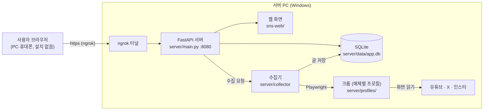

# SNS Collector — SNS 신규글 모아보기

유튜브(영상·게시물), X, 인스타그램에서 보고 싶은 계정의 새 글을 **한 화면에 모아 보는** 웹 서비스입니다.
사용자는 아무것도 설치하지 않고 **아이디·비밀번호로 로그인만** 하면 됩니다.
글은 서버 PC가 미리 로그인해 둔 테스트 계정으로 각 사이트 화면을 읽어서 모읍니다(공식 API·유료 서비스 없음).

- 팀: WebMonster ([WM-WebMonsters](https://github.com/WM-WebMonsters))

---

## 구조



| 폴더 | 역할 |
|---|---|
| `server/` | Python 서버. 로그인 API, 글·추적 계정 API, 수집기(Playwright) |
| `sns-web/` | 웹 화면 (HTML/CSS/JavaScript, 빌드 없음). 서버가 그대로 제공 |
| `sns-collector-extension-v0.19.14/` | 예전 크롬 확장 버전 (참고용, 지금은 사용하지 않음). 수집 스크립트는 `server/collector/scripts/`로 옮겨 씀 |

### 동작 방식

1. 사용자가 웹에서 추적할 계정(`@핸들`·프로필 주소·이름 검색)을 추가합니다.
2. **지금 최신화**를 누르면 서버의 수집기가 서버 PC의 크롬 창을 열어 계정 페이지를 차례로 방문합니다.
   페이지 안에서는 `server/collector/scripts/*.js`(예전 확장의 수집 코드)가 스크롤하며 글을 읽어 서버로 넘깁니다.
3. 서버가 켜져 있으면 **1시간마다 모든 사용자의 추적 계정을 자동으로** 모읍니다(겹치는 계정은 한 번만).
4. 글은 DB에 한 번만 저장되고, 같은 계정을 추적하는 사용자끼리 함께 씁니다. 추적 계정·설정·본 글 기록은 사용자별로 저장됩니다.

---

## 서버 실행 (관리자)

준비물: **Windows PC, Python 3.12, 구글 크롬, ngrok 계정**

### 처음 한 번

1. **Python 설치**: python.org에서 3.12 설치. 첫 화면에서 *Add python.exe to PATH* 체크.
2. **패키지 설치**: `server\setup.bat` 더블클릭 → "Setup complete"가 나오면 완료.
3. **ngrok 설치·등록**
   ```bat
   winget install ngrok.ngrok
   ngrok config add-authtoken <대시보드의 토큰>
   ```
   ngrok 대시보드 → Domains에서 받은 고정 주소를 `server\start.bat`의 `NGROK_URL`에 적습니다.
4. **테스트 계정 로그인**: `server\login_setup.bat` 실행 → 열린 크롬 창에서 매체별 테스트 계정으로 로그인 → 창을 닫습니다.
   - 서버가 켜져 있으면 먼저 끄세요(같은 크롬 프로필을 동시에 쓸 수 없습니다).
   - 특정 매체만: `login_setup.bat x`
   - 유튜브는 로그인하지 않아도 채널 글을 모을 수 있습니다. X·인스타는 로그인이 필요합니다.

### 매번

`server\start.bat` 더블클릭 → 서버(8080)와 ngrok이 함께 켜집니다. 끌 때는 두 창을 닫습니다.

- 내 PC에서 확인: <http://localhost:8080>
- 다른 기기에서: `start.bat`에 적은 ngrok 주소

---

## 파일 구성

### `server/`

| 파일 | 하는 일 |
|---|---|
| `main.py` | 서버 시작점. API 연결, 웹 화면 제공, 응답 압축, 수집기 시작 |
| `auth.py` | `/api/auth` 가입·로그인·로그아웃·비밀번호 변경·계정 삭제. 비밀번호는 scrypt 해시, 세션 30일, 로그인 실패는 IP당 15분에 10회 제한 |
| `api_call.py` | `/api/call` 글 목록(`get`)·추적 계정 저장(`set`)·수집 요청(`checkNow`)·이름 검색(`searchAccount`) 등 |
| `sync.py` | `/api/sync` 본 글 기록(흐리게 표시)을 기기 간에 맞춤 |
| `db.py` | SQLite 테이블: `users`, `sessions`, `user_state`, `items`, `seen`, `kv`, `rate_limits` |
| `collector/runner.py` | 수집기. 작업 스레드 하나에서 Playwright로 크롬을 다룸. 사용자 요청·검색·자동 수집(1시간)·로그인 상태 확인 |
| `collector/scripts/` | 페이지에 넣는 수집 스크립트(`common.js` + 매체별 `youtube.js`·`x.js`·`instagram.js`) |
| `login_setup.py` | 테스트 계정 로그인용으로 매체별 크롬 프로필을 보통 크롬 창으로 엶 |
| `setup.bat` / `start.bat` / `login_setup.bat` | 설치 / 서버+ngrok 실행 / 테스트 계정 로그인 |

### `sns-web/`

| 파일 | 하는 일 |
|---|---|
| `index.html` | 화면 뼈대 |
| `style.css`, `bento.css` | 모양 (bento 디자인, 다크 모드) |
| `js/core.js` | 상수·상태, 서버 호출 함수 `apiPost` |
| `js/bridge.js` | 서버 요청 함수 `call(op)`, 연결 표시, 매체 로그인 상태 아이콘 |
| `js/store.js` | 서버 상태 읽기(수집 중 3초 / 평소 30초), 본 글 기록 동기화 |
| `js/list.js` | 탭·카드·글 뷰어(임베드), 이전/다음 이동 |
| `js/tracking.js` | 계정 입력 해석, 추가/삭제, 묶음, 이름 검색 |
| `js/account.js` | 로그인·가입·계정 관리 |
| `js/ui.js` | 휠 스크롤, 이어보기, 도움말, 시작 코드 |

`js/` 파일은 전역 변수를 서로 공유하는 일반 스크립트라서 `index.html`에 적힌 순서(core → bridge → store → list → tracking → account → ui)를 바꾸면 안 됩니다.

---

## 저장되는 데이터

| 위치 | 내용 | 한도 |
|---|---|---|
| `server/data/app.db` | 계정(비밀번호 해시), 세션, 사용자별 추적 계정·설정·본 글 기록, 글 미리보기(링크·제목·작성자·썸네일 주소·게시 시각) | 글 최대 20,000건(넘으면 오래 전에 모은 것부터 삭제) |
| `server/profiles/<매체>` | 테스트 계정 로그인 정보(크롬 프로필·쿠키) | — |
| 사용자 브라우저 `localStorage` | 로그인 세션, 화면 설정, 프로필 사진 | — |

사진·영상 파일 자체와 사용자의 SNS 비밀번호는 저장하지 않습니다.
`server/data`와 `server/profiles`는 `.gitignore`로 저장소에 올라가지 않습니다. **절대 올리지 마세요.**

---

## 알아둘 한계

- **서버가 켜져 있을 때만** 접속·수집이 됩니다(개인 PC로 필요할 때만 여는 구조).
- **약관**: X·인스타그램은 자동 수집을 제한할 수 있어 수집 속도를 일부러 늦춥니다. 테스트 계정이 잠길 수 있습니다.
- **화면 구조 변경**: 사이트 화면이 바뀌면 수집이 멈출 수 있습니다. `server/collector/scripts/`의 선택자를 고치면 됩니다.
- **게시 시각**: 유튜브는 "3일 전" 같은 표시를 환산해 최대 하루 정도 오차가 있습니다. 인스타그램 프로필 격자에는 날짜가 없어 기간 계산이 가장 부정확합니다.
- **내 피드 미지원**: 사이트 메인 주소(내 구독 피드·홈 타임라인)는 추가할 수 없습니다. 서버 테스트 계정의 피드가 되기 때문입니다.
- **ngrok 무료 한도**: 월 1GB·요청 2만 건. 화면은 평소 30초마다만 서버에 묻고, 바뀐 글이 없으면 목록을 다시 받지 않습니다.
- **비밀번호 분실**: 이메일을 받지 않아 복구가 없습니다. 새 아이디로 가입해야 합니다.

---

## 문제 해결

| 증상 | 해결 |
|---|---|
| `setup.bat`에서 "Python was not found" | Python 3.12 설치(Add to PATH 체크) 후 다시 실행 |
| ngrok 화면에 `ERR_NGROK_8012` | 서버(8080)가 꺼져 있음. `start.bat`의 서버 창 확인 |
| "테스트 계정 크롬 프로필이 다른 창에서 쓰이고 있습니다" | `login_setup`으로 연 크롬 창을 닫고 다시 시도 |
| "크롬을 찾지 못했습니다" | 서버 PC에 구글 크롬 설치 |
| X·인스타 글이 안 들어옴 | 웹의 매체 아이콘이 회색이면 테스트 계정 로그인이 필요. 서버를 끄고 `login_setup.bat` |
| 화면이 예전 그대로 | `Ctrl+Shift+R`로 강력 새로고침 |
